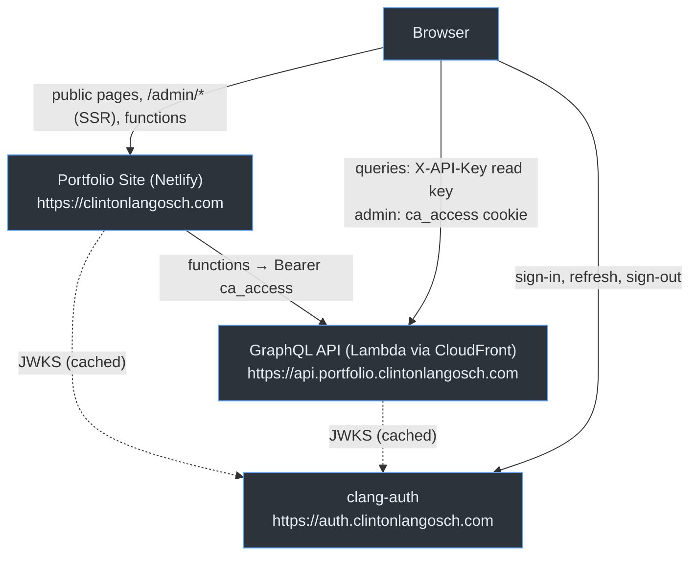
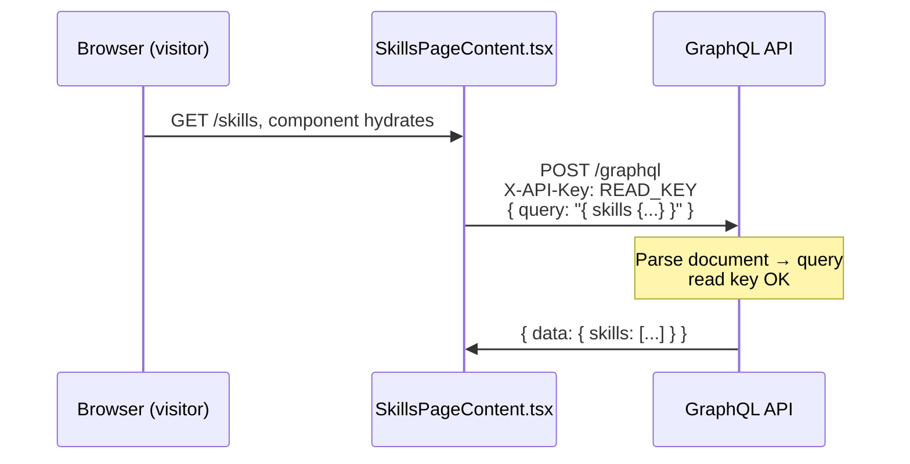
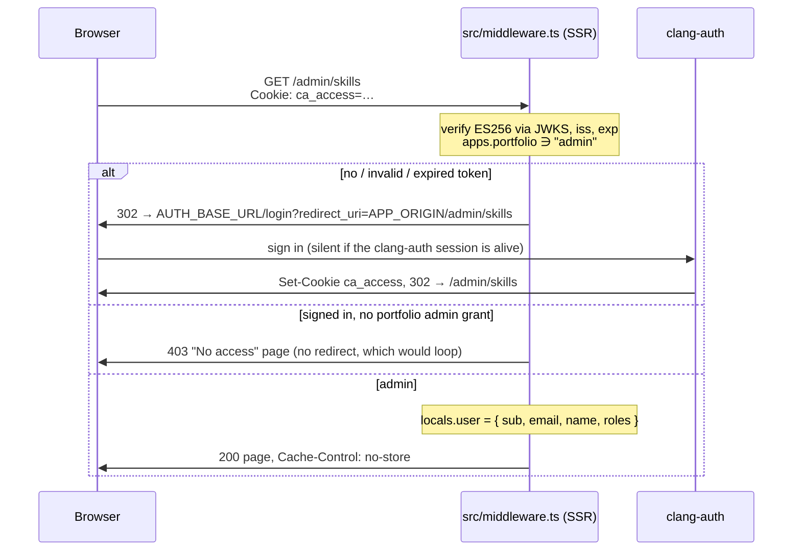
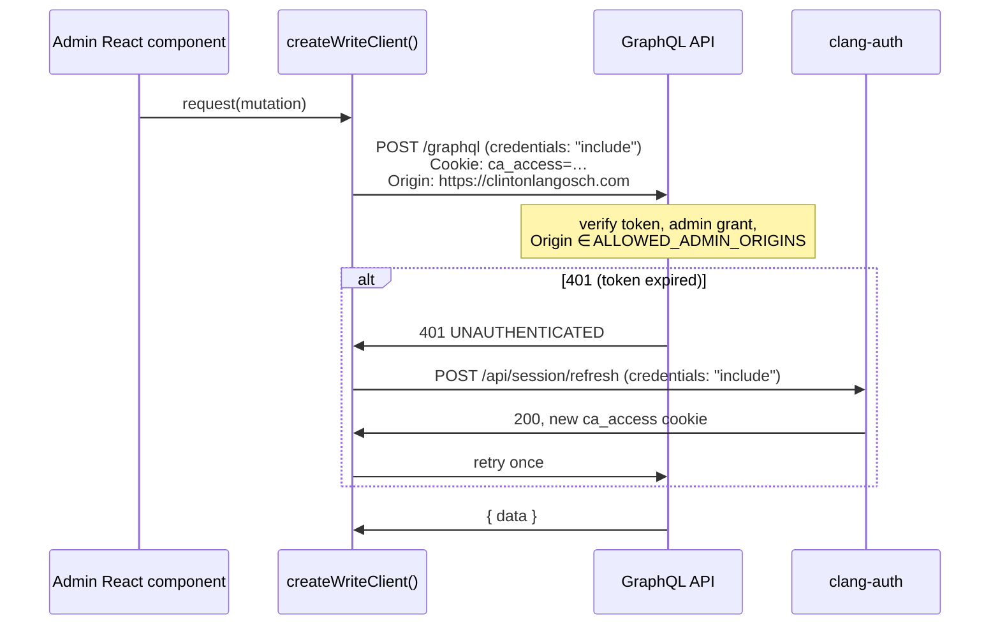
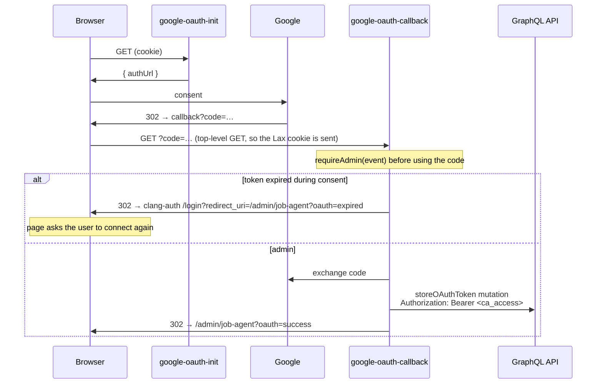

# Authentication & Request Flow Architecture

Admin sign-in uses the shared **clang-auth** service at `https://auth.clintonlangosch.com`. Neither this site nor the GraphQL API stores passwords or signing secrets: both verify a short-lived ES256 access token locally against clang-auth's public JWKS. Migration plan and rollout: [`clang-auth-migration.md`](./clang-auth-migration.md).

## System Overview



### The token

- **`ca_access`**: ES256 JWT set by clang-auth with `Domain=.clintonlangosch.com; HttpOnly; Secure; SameSite=Lax`, valid 15 minutes. Every `*.clintonlangosch.com` host (including the apex) receives it. Page JavaScript can't read it.
- Claims: `sub`, `email`, `name`, `iss` (= `AUTH_BASE_URL`), `exp`, and `apps`, e.g. `{ "portfolio": ["admin"] }`.
- **Admin access** means `apps.portfolio` (the `AUTH_APP_SLUG`) includes `"admin"`.
- Verification (`src/lib/server/clang-auth.ts` here, `api/middleware/clang-auth.ts` in the API): ES256 only, key chosen by `kid` from `${AUTH_BASE_URL}/.well-known/jwks.json` (cached, re-fetched on unknown `kid`), `iss` must equal `AUTH_BASE_URL`, 30 s clock tolerance.

### CSRF

Sibling apps (`lexicon.clintonlangosch.com`, …) are *same-site* with the apex under `SameSite=Lax`, so the cookie alone doesn't prove a request came from this site. Every state-changing request authenticated by the cookie must carry an `Origin` (or, failing that, `Referer`) that matches:

- `APP_ORIGIN` for the site's Netlify functions;
- `ALLOWED_ADMIN_ORIGINS` for the API (cookie-authenticated requests).

Server-to-server calls send the token as `Authorization: Bearer`, which browsers never attach automatically, so they skip the origin check.

## 1. Public pages

Unchanged: public pages query the API with the public read-only key and never contact clang-auth.



The API decides query vs. mutation by **parsing** the GraphQL document (`graphql`'s `parse()`), so a comment, fragment or second operation before `mutation` can't sneak a mutation past the read key. Unparsable documents get `400`.

## 2. Opening an admin page



- `/admin/login` is kept for old bookmarks: signed out, the middleware sends you to clang-auth (returning to `/admin`); signed in, the page redirects to `/admin`.
- `AdminLayout.astro` shows "Signed in as …" from `Astro.locals.user`. No key or token is written into page JavaScript.

## 3. Admin GraphQL requests



- `createWriteClient()` (`src/lib/graphql-client.ts`) sends no `X-API-Key` and no `Authorization` header; it relies on the cookie. Its `fetch` is `authFetch()` (`src/lib/auth-client.ts`), which on a `401` refreshes the session and retries once, or sends the user to sign in if the refresh fails.
- Admin queries are also authorized by the cookie, so the admin UI needs no API key at all.
- API error codes are unchanged: `UNAUTHENTICATED` (401) and `FORBIDDEN` (403) in `errors[].extensions.code`.
- The API's CORS config allows credentials for an exact origin list (never `*`) and the `Content-Type`, `Authorization` and `X-API-Key` headers.

## 4. Admin Netlify functions

`ai-assistant`, `google-drive-status`, `google-oauth-init`, `google-drive-upload`, `google-oauth-callback` and `auth-me` call `requireAdmin(event)` from `src/lib/server/clang-auth.ts`:

- Reads only the `ca_access` cookie (an `Authorization` header from a browser is ignored).
- `401` signed out/expired, `403` no admin grant, `403` for a `POST/PUT/PATCH/DELETE` whose `Origin`/`Referer` isn't `APP_ORIGIN`.
- Returns the user and the raw token. Functions that call the API forward it as `Authorization: Bearer <ca_access>`.
- They're same-origin only: no `Access-Control-Allow-Origin` headers.

The browser calls them through `authFetch()`, so an expired token is refreshed transparently.

`auth-me` returns `{ email, name, roles }` for the signed-in admin (used by `AuthProvider`).

### Google Drive OAuth



`getOAuthTokenWithCredentials` returns the stored refresh token, so the API serves it only to admin callers (a clang-auth admin token, or the legacy write key during the transition), never to the public read key. `google-drive-upload` fetches it with the forwarded Bearer token.

## 5. Signing out

The **Sign out** button calls `logout()` (`src/lib/auth-client.ts`): `POST ${PUBLIC_AUTH_BASE_URL}/logout` with `credentials: "include"`, then navigates to `/`. This ends the clang-auth session for **every** app on the domain.

## Environment variables

### Portfolio site (Netlify)

```bash
PUBLIC_GRAPHQL_ENDPOINT=https://api.portfolio.clintonlangosch.com/graphql
GRAPHQL_ENDPOINT=https://api.portfolio.clintonlangosch.com/graphql   # functions
PUBLIC_GRAPHQL_READ_KEY=<read-key>

AUTH_BASE_URL=https://auth.clintonlangosch.com          # server: verification + redirects
PUBLIC_AUTH_BASE_URL=https://auth.clintonlangosch.com   # browser: refresh, sign-out (build time)
AUTH_APP_SLUG=portfolio
APP_ORIGIN=https://clintonlangosch.com
```

### GraphQL API (Lambda)

```bash
API_READ_KEY=<read-key>
AUTH_BASE_URL=https://auth.clintonlangosch.com
AUTH_APP_SLUG=portfolio
ALLOWED_ADMIN_ORIGINS=https://clintonlangosch.com

# Legacy, transition only (remove in rollout step 4):
API_WRITE_KEY=<write-key>
AUTH_SECRET=<hs256-secret>
```

## Files

```
src/
├── middleware.ts                 # /admin/* gate: verify ca_access, redirect/403, locals.user
├── lib/
│   ├── server/clang-auth.ts      # verifyAccessToken, authenticateToken, requireAdmin
│   ├── auth-client.ts            # loginUrl, refreshSession, authFetch, fetchMe, logout
│   └── graphql-client.ts         # read-only client (read key) / write client (cookie)
├── layouts/AdminLayout.astro     # "Signed in as …", Sign out
└── components/admin/AuthProvider.tsx  # client-side user from auth-me

netlify/functions/
├── auth-me.ts                    # { email, name, roles } or 401/403
├── ai-assistant.js               # requireAdmin
├── google-drive-status.js        # requireAdmin
├── google-oauth-init.js          # requireAdmin
├── google-oauth-callback.js      # requireAdmin, forwards Bearer token
└── google-drive-upload.js        # requireAdmin, forwards Bearer token
```

## Local development

Cookies need a shared parent domain, so use `*.localtest.me` (resolves to 127.0.0.1), not `localhost`:

- clang-auth at `http://auth.localtest.me:4000`, with the dev app registered:
  `clang-auth app create portfolio --name Portfolio --origin http://portfolio.localtest.me:8080` and
  `clang-auth grant set dev@localtest.me portfolio --role admin`.
- This site via `netlify dev`, opened at `http://portfolio.localtest.me:8080`, with
  `AUTH_BASE_URL`/`PUBLIC_AUTH_BASE_URL=http://auth.localtest.me:4000`, `AUTH_APP_SLUG=portfolio`, `APP_ORIGIN=http://portfolio.localtest.me:8080`.
- The API at `http://api.portfolio.localtest.me:<port>` with `ALLOWED_ADMIN_ORIGINS=http://portfolio.localtest.me:8080`; point `PUBLIC_GRAPHQL_ENDPOINT`/`GRAPHQL_ENDPOINT` at it.
- API-only testing: `TOKEN=$(clang-auth token mint dev@localtest.me --ttl 1h)` and `curl … -H "Authorization: Bearer $TOKEN"`.

## Known limitations

- Deploy previews (`*--clintonlangosch.netlify.app`) never receive the cookie, so admin doesn't work there.
- Signing out is global across `*.clintonlangosch.com`.
- Revoking a grant takes effect within the 15-minute token lifetime, not instantly.
